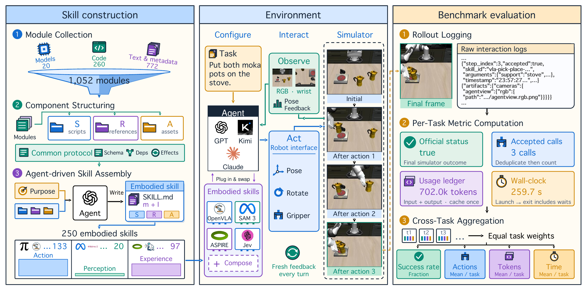

<div align="center">

# EmbodiedSkillBench

### Benchmarking How Well Agents with Embodied Skills Perform on Physical Tasks

**Reusable embodied capabilities. Closed-loop physical interaction. Measurable skill utility.**

<p>
  <a href="#overview">Overview</a> &nbsp;·&nbsp;
  <a href="#key-results">Results</a> &nbsp;·&nbsp;
  <a href="#getting-started">Get started</a> &nbsp;·&nbsp;
  <a href="RUN_BENCH.md">Run the benchmark</a> &nbsp;·&nbsp;
  <a href="evaluation/README.md">Evaluation</a>
</p>

<p>
  
  
  
  <a href="https://github.com/HanZhi306/EmbodiedSkill-Bench/actions/workflows/checks.yml"></a>
</p>



<p><sub>Figure 2 from the manuscript. From heterogeneous embodied modules to reusable skills and trace-based evaluation.</sub></p>

</div>

> **Public code release.** The benchmark runtime, construction tools, Clean100 roster, and offline evaluator are available. The paper's 250 skill packages, skill indexes, and source-resource snapshots are **not included** in this release. Native control can run without them; skill-based experiments require separately supplied local packages. See [release scope](docs/release-scope.md).

## Overview

EmbodiedSkillBench measures **when reusable embodied skills help an agent solve physical tasks, and at what execution cost**. It packages heterogeneous action models, perception interfaces, and procedural knowledge as agent-readable skills, then compares agents under a shared observation-action protocol.

The paper studies three modes:

| Mode | Agent behavior |
| :--- | :--- |
| **Native control** | Plans and acts through typed robot controls without a skill library. |
| **Skill-only execution** | Solves the task with the supplied action, perception, and experience skills. |
| **Agent-Directed Reuse (ADR)** | Retains native control and decides whether to invoke, modify, combine, or ignore skills. |

The current public launcher supports native control and skill use with local packages. The standalone ADR and Jev experiment integrations are not part of this code release.

<div align="center">

| Resource modules¹ | Embodied skills¹ | Perturbed task cases | Evaluation metrics |
| :---: | :---: | :---: | :---: |
| **1,052** | **250** | **100** | **4** |
| Models, code, text & metadata | Action · Perception · Experience | 25 base tasks × 4 perturbations | Success · Actions · Tokens · Time |

</div>

<sub>¹ Corpus statistics describe the manuscript's repository; the corpus and skill assets are not distributed here.</sub>

## Key results

**Skills supply missing capability, but their value depends on what the agent can already do.** Under common selected skill provision, the first three agents improve in success and use fewer tokens. GPT-6-Astra succeeds more often with native control, exposing a tradeoff between skill restrictions and execution cost.

| Agent | Native SR | With-skill SR | Change | Token reduction |
| :--- | ---: | ---: | ---: | ---: |
| GPT-5.6-Sol | 11% | **63%** | +52 pp | 85.0% |
| Kimi-K3 | 43% | **62%** | +19 pp | 58.0% |
| Claude-Opus-5 | 44% | **64%** | +20 pp | 76.7% |
| GPT-6-Astra | **92%** | 61% | −31 pp | 75.5% |

**Selective reuse recovers much of the stronger agent's success while reducing cost.** With GPT-6-Astra, ADR reaches 85% success using 14.1% fewer tokens and 11.9% less time than native control. Jev delegates local motion decisions and further reduces execution cost, with a larger success tradeoff.

| GPT-6-Astra configuration | SR | Actions / task | Tokens / task (k) | Time / task (min) |
| :--- | ---: | ---: | ---: | ---: |
| Native control | **92%** | 16.59 | 2,300.6 | 20.52 |
| Skill-only | 61% | **2.24** | **563.5** | **3.40** |
| Agent-Directed Reuse | 85% | 12.87 | 1,976.3 | 18.09 |
| With Jev skill | 81% | 20.90 | 1,142.0 | 8.74 |

<sub>Reported manuscript results on Clean100, seed 26. SR is official task success; effort metrics are per-task means including failures. Tokens count recorded input and output, including cached input once. These values have not been regenerated from public rollout archives in this release.</sub>

→ [Full result tables and experimental settings](docs/results.md)

## Getting started

Use Python 3.10–3.12; Python 3.12 is recommended. The source check and offline evaluator do not need a GPU or model API.

```bash
git clone https://github.com/HanZhi306/EmbodiedSkill-Bench.git
cd EmbodiedSkill-Bench

python3.12 -m venv ../esb-venv
source ../esb-venv/bin/activate
python -m pip install -e .
esbench doctor
```

`doctor` validates the frozen 100-task roster and reports `skill_assets: "not_included"` for this public checkout. If a local skill pool and index are supplied, it also checks their file inventory and hashes. It does not validate simulator installation or API access.

Real simulator runs require **Linux, an NVIDIA GPU with EGL support, bubblewrap, LIBERO-Pro data/assets, and an authenticated agent CLI**. The paper's native interface uses **P3 joint-position control with an audited PyRoKi IK service**. The setup guide distinguishes it from the P2.5 OSC development interface.

| I want to… | Start here |
| :--- | :--- |
| Run native control on LIBERO-Pro | [Installation and execution](RUN_BENCH.md) |
| Compute metrics from archived episodes | [Offline evaluation](evaluation/README.md) |
| Build skills from my own local resources | [Skill construction](docs/skill-construction.md) |
| Understand what is available now | [Release scope](docs/release-scope.md) |

## Code map

```text
EmbodiedSkill-Bench/
├── src/embodied_skill_bench/
│   ├── agents/           # CLI harnesses and isolated agent execution
│   ├── experiments/      # Skill-use, native-control, and direct-VLA runners
│   └── runtime/          # Typed controls, simulator adapters, and episode traces
├── configs/              # Clean100 roster and dependency revisions
├── evaluation/           # Per-task metrics, aggregation, and archived replay
├── scripts/              # Resource collection, structuring, and materialization
├── inputs/               # Editable construction examples
├── prompts/              # Skill-authoring instructions
├── protocol.json         # Module-access and assembly-plan schemas
└── docs/                 # Results, release scope, and construction guide
```

## Evaluation protocol

Clean100 crosses **25 base tasks** with **language, object, task, and swap perturbations**. It contains 24 LIBERO-10, 28 Goal, 24 Object, and 24 Spatial cases, all at environment seed 26. The roster records task-file hashes and VLA seeds.

| Metric | What is measured |
| :--- | :--- |
| **Success** | Official final simulator task status, reconciled with the episode summary. |
| **Actions** | Accepted state-changing agent calls, deduplicated and reconciled with the runtime counter. |
| **Tokens** | Recorded model input + output usage, with cached input counted once. |
| **Time** | Agent launch to exit, including model calls, tools, and waiting. |

Read-only queries and low-level simulator steps do not count as agent actions. Aggregation gives each task equal weight and retains failed tasks. Missing token usage stays unavailable; see the [evaluator guide](evaluation/README.md) for coverage and audit details.

## Acknowledgments

The benchmark builds on [LIBERO](https://github.com/Lifelong-Robot-Learning/LIBERO), [LIBERO-Pro](https://huggingface.co/datasets/zhouxueyang/LIBERO-Pro), [RPent](https://github.com/RLinf/RPent), [PyRoKi](https://github.com/chungmin99/pyroki), and [CaP-X](https://github.com/capgym/cap-x), alongside the action, perception, and experience resources described in the manuscript. External code, data, and model checkpoints retain their upstream licenses and access requirements.

The paper's full title is **Embodied Skill Bench: Benchmarking How Well Agents with Embodied Skills Perform on Physical Tasks**. A paper link and final citation metadata will be added when available.
